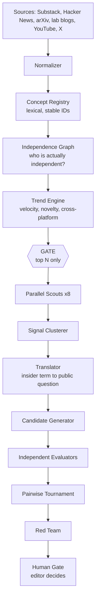

# Frontier Scout

A live editorial intelligence system for discovering high-potential documentary
and explainer topics at the technological frontier.

Frontier Scout does not brainstorm video ideas. It **observes real information
flows**, measures what is actually moving among knowledgeable insiders, and
translates that into questions an intelligent non-specialist would want
answered — before the story becomes obvious to everyone.

> **Channel promise:** understand the technological frontier well enough to
> participate intelligently in the conversation about where it is taking us.

---

## 1. What it does

It looks for topics at the intersection of:

```
CURRENT INSIDER ATTENTION  +  REAL TECHNICAL CHANGE  +  CONSEQUENCE
 +  PUBLIC CONFUSION  +  SERIOUS DISAGREEMENT
 +  GENERAL-AUDIENCE STORY POTENTIAL  +  WEAK EXISTING EXPLANATION
```

The core discipline is refusing this equation:

```
TRENDING TERM  ≠  GOOD VIDEO
```

Instead the system traces:

```
SIGNALS → UNDERLYING CHANGE → TECHNICAL MECHANISM
        → HUMAN CONSEQUENCE → DISAGREEMENT → PUBLIC QUESTION
```

So five buzzwords (`prompt engineering`, `context engineering`,
`harness engineering`, `loop engineering`, `graph engineering`) do not become
five explainer videos. They become one underlying change — *AI engineering is
shifting from writing instructions to designing systems around models* — and
one public question: **"The End of Prompting?"**

## 2. Architecture



Everything **above the gate is free and deterministic**. Everything below it
costs money. The quantitative layer exists to decide what deserves an LLM —
which is why a run with no LLM budget at all still produces a useful ranked
momentum table.

### Why multiple agents

One giant prompt asked to "find good video ideas" produces confident mush. Eight
narrow scouts, each blind to the others' output, produce *disagreeing* views
that can be compared — and each is small enough to debug, test and re-prompt in
isolation.

| Scout | Question |
|---|---|
| Trend | What is meaningfully accelerating? (new term vs new idea vs old idea relabelled) |
| Frontier | What actually changed technically? |
| Disagreement | Where do credible people read the same evidence differently? |
| Human Consequence | If this is real, what changes for someone outside the field? |
| Mechanism | What must the audience understand to follow this? |
| Capital | What are serious organisations spending on? |
| Story | What makes this a story rather than an explainer? |
| Coverage | Has this already been explained well to a broad audience? |

### Why generators and evaluators are separate

A model asked to rate its own idea rates it highly. Generation and evaluation
are separate calls with separate prompts, and evaluators never see which
generator produced a candidate. Because LLM scoring also compresses — everything
becomes a 7 or an 8 — numeric scores are followed by a **pairwise tournament**
where candidates compete head-to-head, and the two rankings are stored
separately rather than averaged into one number.

## 3. Install

```bash
uv venv --python 3.12 .venv
uv pip install --python .venv/bin/python -e ".[dev]"
cp .env.example .env        # optional; see below
```

**The four core connectors need no credentials.** Substack RSS, Hacker News,
arXiv and the lab blogs all work out of the box. `ANTHROPIC_API_KEY` is needed
only for the agent layer; `YOUTUBE_API_KEY` only for coverage analysis.

## 4. Run

```bash
frontier-scout collect              # gather real source material
frontier-scout trends               # compute momentum; no LLM calls, no cost
frontier-scout discover             # multi-agent editorial discovery
frontier-scout review <run_id>      # human gate
frontier-scout export <run_id>      # JSONL / markdown artifacts
frontier-scout daily                # collect -> trends -> discover -> brief
```

First run should be:

```bash
frontier-scout collect --backfill 90
```

Backfill matters: Hacker News (via Algolia), arXiv and Substack all expose
history, so baselines are real on day one instead of empty for a month.

Inspect anything at any time:

```bash
frontier-scout trends --top 30      # ranked momentum table
sqlite3 data/frontier_scout.db "SELECT canonical_label, insider_momentum FROM ..."
```

## 5. Adding sources

Edit YAML, never Python:

| File | Controls |
|---|---|
| `config/substack_feeds.yaml` | newsletters, with editor-assigned `curated_tier` |
| `config/primary_feeds.yaml` | lab/company blogs (`mode: rss` or `mode: sitemap`) |
| `config/arxiv_queries.yaml` | categories and phrase searches |
| `config/hacker_news.yaml` | which HN feeds, backfill depth |
| `config/youtube_queries.yaml` | coverage settings and quota ceiling |
| `config/x_queries.yaml`, `config/x_accounts.yaml` | X monitoring and expert lists |
| `config/concepts.yaml` | the seed concept registry and aliases |
| `config/editorial.yaml` | scoring weights, models, gate width, budgets |

## 6. Inspecting intermediate artifacts

Every run writes `data/runs/<run_id>/`:

```
01_sources.jsonl     what was ingested
02_signals.jsonl     what each scout observed, with citations
03_clusters.json     surface terms resolved into underlying changes
04_candidates.json   proposed videos
05_evaluations.json  independent scores
06_pairwise.json     head-to-head judgements, one row per question
07_red_team.json     attacks on the finalists
08_finalists.json    what reaches the editor
run_summary.md       human-readable
daily_brief.md       the 5-15 signal editorial brief
```

## 7. Provenance

This requirement is absolute. Every factual statement derived from ingestion
keeps its `source_id`, `url`, `author` and `timestamp`. Model reasoning is
stored under a different `kind` (`INFERENCE`) in the same table, so no rendering
path can blur the two.

It is enforced mechanically, not by asking a prompt nicely: a `SOURCE_FACT`
claim with no citation fails Pydantic validation, and any claim citing a
`source_id` that was not in that call's input set is rejected as a fabricated
citation, repaired once, then dropped and logged.

## 8. Honest failure

When a source cannot be reached, the system reports `SOURCE_UNAVAILABLE` and
continues. It never fabricates, never substitutes a different metric, and marks
every downstream score with reduced `data_completeness`.

Notably, without Google Trends API access (it is alpha and application-gated)
the public-interest signal reports `NOT_AVAILABLE`. Insider attention and public
interest are *different signals*, and quietly swapping one for the other would
defeat the entire coverage-gap thesis.

## 9. How future outline generation attaches

This MVP deliberately stops at the human gate. It does not write outlines,
scripts, visuals or thumbnails.

When that work comes, it attaches at `human_reviews.decision = 'APPROVE'`: an
approved candidate already carries its cluster, its full source set, its
mechanism, its disagreement map and its open investigation questions — which is
most of a research brief. The `video_outcomes` table exists (empty) so published
performance can be joined back to the scoring components that predicted it, and
the momentum weights in `config/editorial.yaml` refit against what actually
worked.

## 10. Design priorities

```
TRANSPARENCY   > AUTONOMY
INSPECTABILITY > CLEVERNESS
PROVENANCE     > FLUENCY
SMALL AGENTS   > GIANT PROMPTS
HUMAN JUDGMENT > AUTOMATED FINAL DECISION
```

This is an editorial decision-support system. It surfaces unusually strong
ideas. It does not replace the editor.

See `docs/ARCHITECTURE.md` for the full design, the verified API-access
findings, and the measurement traps this system is built to avoid.
